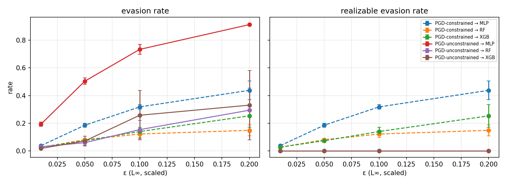
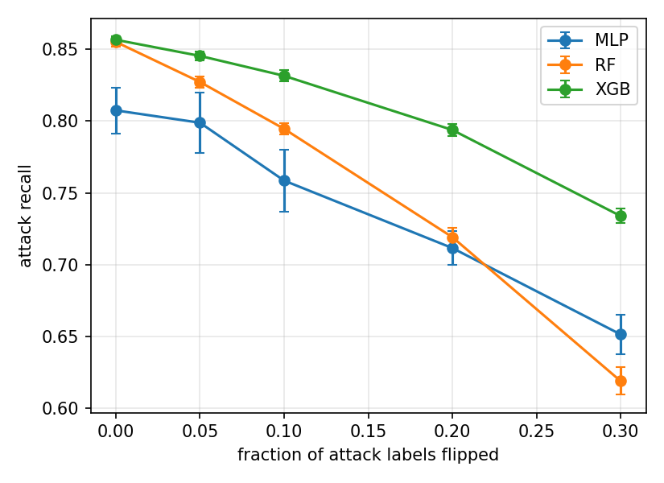

# Constraint-Aware Adversarial-Robust NIDS (CIC-IoT2023 + TON_IoT)

**Question.** Evasion attacks against ML network intrusion detectors often report high success rates. How many of those successes could actually happen as real traffic? And how much robustness does constraint-aware adversarial training buy, at what cost in clean accuracy?

## Results
Data: 18 CIC-IoT2023 per-class CSVs (benign + 17 attacks, 3.13M rows) → stratified sample of 59,806 benign + 59,806 attack flows, 36 features (`IAT`, `Number` dropped). Mean ± std over seeds 42/123/456/789/1024. Full tables: [`results/RESULTS.md`](results/RESULTS.md).

**Clean detection (binary, test set)**

| model | F1 | AUC | recall |
|---|---|---|---|
| XGB | 0.885 ± 0.003 | 0.957 ± 0.002 | 0.857 ± 0.003 |
| RF  | 0.879 ± 0.003 | 0.951 ± 0.002 | 0.855 ± 0.003 |
| MLP | 0.833 ± 0.003 | 0.923 ± 0.003 | 0.808 ± 0.016 |

**Key findings**
1. **Unconstrained evasion is not realizable.** White-box PGD evades the MLP on 91.3% of flows at ε=0.2, but **0%** of those adversarial examples pass the constraint audit. Every one of them changes an immutable feature.
2. **Constrained evasion is still a real threat.** Under the threat-model constraints, PGD evades the MLP on 43.8 ± 6.8% of flows at ε=0.2 and transfers to XGB on 25.3 ± 8.2%. A decision-only HopSkipJump attack (label-only query access, restricted to modifiable features, 100% realizable) evades XGB directly on **43.2% of flows (95% Wilson CI 40.7–45.7%, n=1,500 over 5 seeds)** and RF on **18.7% (CI 14.7–23.5%, n=300)**. No flow hit the 120 s per-flow time limit. So even the strongest clean detector is not robust to a black-box attacker who respects the threat model.
3. **Poisoning:** flipping 30% of attack labels cuts recall from 0.855 to 0.619 for RF and from 0.857 to 0.734 for XGB. XGB degrades the least.
4. **Adversarial training: offline retraining fails, per-batch (Madry) training works.** Two rounds of offline retraining on constrained-PGD examples did *not* help (robust recall at ε=0.1 was 0.466 vs. 0.517). Per-batch Madry-style training, with constraints projected at every PGD step, raises robust recall against an adaptive constrained PGD attacker at ε=0.1 from **0.517 ± 0.013 to 0.789 ± 0.022**, and at ε=0.2 from 0.426 to 0.787. Both models are compared at an equal false-positive rate (0.132, with the threshold calibrated on the validation set). The cost is a small drop in clean F1, from 0.832 to 0.826. **Gradient-masking check:** attacks transferred from the baseline model are *weaker* against the Madry model than its own white-box attack (recall 0.880 vs. 0.789), which is the expected order if the robustness is genuine.
5. **Detecting adversarial examples, as an alternative to robust training.** These are unsupervised detectors with a 5% false-alarm budget, and the attacks are not adapted to them. Scores below are AUC on *successful* evasions vs. clean flows.

   | attack on MLP | confidence of adversarial examples | Feature squeezing | Manda-style |
   |---|---|---|---|
   | constrained PGD, ε=0.2, 3 steps | 0.39 | 0.73 ± 0.05 | **0.82 ± 0.03** |
   | constrained PGD, ε=0.2, 50 steps | 0.84 | 0.41 ± 0.03 | **0.76 ± 0.03** |
   | unconstrained PGD, ε=0.1, 50 steps | 0.92 | 0.26 ± 0.02 | **0.83 ± 0.02** |

   **Feature squeezing fails against high-confidence attacks.** Its AUC falls *below* chance, because strong PGD pushes flows deep into the benign region, where squeezing barely changes the output. The **Manda-style** detector stays at 0.76–0.83 AUC whatever the attack's confidence. However, at a 5% false-alarm rate it flags only 4–27% of successful evasions. Adding it to the MLP raises attack recall under 50-step constrained PGD only from 0.524 to 0.570. **Madry adversarial training (0.787 recall at ε=0.2) is the much stronger defense here.**
6. **Backdoor poisoning is cheap and hard to remove.** The attack is dirty-label: the trigger sets `Header_Length` and `Tot size` to their train 99.5th percentile, projected to be 100% realizable, and triggered malicious flows are injected labelled benign. ASR is the fraction of flows the clean model detects that are missed once triggered.

   | poison rate (flows) | XGB ASR | RF ASR | MLP ASR | XGB clean F1 |
   |---|---|---|---|---|
   | 0 (control: trigger alone) | 0.020 | 0.019 | 0.226 | 0.885 |
   | 0.1% (83) | **0.925 ± 0.040** | 0.738 ± 0.045 | 0.884 ± 0.041 | 0.885 |
   | 1% (837) | 0.999 | 0.988 | 0.994 | 0.886 |

   Poisoning just **0.1% of the training set** gives a 92.5% ASR on XGB, with **no change in clean F1**, so the backdoor is invisible to normal validation. **The spectral-signature defense** (Tran et al., 2018) has a paradox: it finds poison better when there is more of it (it removes 5% of the poison at a 0.1% rate but 97% at a 2% rate), yet the few poisoned flows left are enough to keep the backdoor working. At a 2% rate, after 97% removal, ASR is still 0.786 on XGB, 0.624 on MLP and 0.429 on RF. Tree models, especially XGB, learn the trigger from very few examples.

## Cross-dataset check: TON_IoT
Same pipeline, same protocol, a different dataset and a different threat model. TON_IoT (UNSW Canberra) is Zeek connection logs, so it shares no features with CIC-IoT2023 and no model can transfer between them; what is tested is whether the *findings* replicate. Sample: 19,926 benign + 19,926 attack flows over 9 attack types, 112 features after one-hot encoding (39,011 exact duplicate rows removed). Threat model: the attacker controls its own side of the connection, so `duration`, `src_bytes`, `src_pkts`, `src_ip_bytes` are modifiable and increase-only, `dst_*` are the victim's responses and immutable, with `src_ip_bytes >= src_bytes` enforced. Results: [`results/toniot/RESULTS.md`](results/toniot/RESULTS.md).

| | CIC-IoT2023 | TON_IoT | replicates? |
|---|---|---|---|
| Clean F1 (XGB) | 0.885 | 0.995 | — (TON_IoT is far easier) |
| Unconstrained PGD: evasion / realizable | 0.91 / **0.00** | 1.00 / **0.00** | yes |
| Constrained PGD, ε=0.2 (MLP, white-box) | 0.44 | 0.18 | yes, weaker |
| HopSkipJump on XGB | 0.432 (CI 0.407–0.457) | 0.030 (CI 0.023–0.040) | direction only |
| Madry AT robust recall, ε=0.2 (vs. baseline) | **0.787** vs. 0.426 | **0.935** vs. 0.776 | yes |
| Label-flip 30%: RF / XGB recall | 0.619 / 0.734 | 0.745 / 0.949 | yes (XGB more robust) |
| Backdoor at 0.1% poison (XGB ASR) | 0.925 | 0.968 | yes |

**What replicates:** unconstrained adversarial examples are never realizable on either dataset; constrained attacks are weaker but real; Madry adversarial training is the strongest defense in both; XGB survives label-flip poisoning better than RF; and a 0.1% backdoor works on both.

**What differs, and why it matters:**
- **Detection flips.** On TON_IoT, feature squeezing is excellent against constrained attacks (AUC 0.97–1.00) but again collapses against high-confidence unconstrained attacks (AUC 0.14). The consistent rule across both datasets is not "squeezing works" but "squeezing fails once adversarial examples are pushed far past the boundary".
- **The backdoor hits only the tree models.** On TON_IoT, 0.1% poison gives ASR 0.92 (RF) and 0.97 (XGB), while the MLP stays at 0.003. The MLP simply never learns this trigger.
- **The spectral-signature defense removes 0% of the poison on TON_IoT**, versus up to 97% on CIC-IoT2023. This exposes a real dependency: spectral signatures read the *MLP's* activations, so when the MLP is not backdoored there is no signature to find, while RF and XGB remain fully backdoored. A defense that inspects one model cannot protect an ensemble of others.

 

## Threat model
- **Attacker goal:** get a malicious flow classified as benign, while keeping it malicious.
- **Capabilities:** the attacker controls its own packets. It can pad payloads and insert delays, so size and duration aggregates (`Header_Length`, `Tot sum`, `Tot size`, `Max`) can only **increase**. `AVG` and `Std` can change within relational bounds.
- **Immutable features:** protocol type, flag counts and all other features are set by the attack itself.
- **Relational constraints:** `Min ≤ AVG ≤ Max` and `Std ≤ (Max − Min)/2`. Both hold per window, so they also hold for window averages.
- **TON_IoT has its own threat model** (source-side volume and duration, increase-only; `dst_*` immutable), defined in `config.py` alongside this one.
- **Knowledge:** white-box on the MLP (PGD), transfer from the MLP to RF/XGB, and decision-only black-box on XGB (HopSkipJump).

`src/constraints.py` projects attacks into this space and **audits** unconstrained attacks. The audit reports the *realizable evasion rate*: an example counts only if it both evades the detector and satisfies every constraint. Constrained attacks score 1.0 on realizability by construction, so the informative number for them is evasion.

## Pipeline
| Step | Script | What it does |
|---|---|---|
| 0 | `inspect_data.py` | Prints the columns and label distribution. Check these before trusting any assumption. |
| 1 | `data.py` | Streams the CSVs, samples each class separately (≤60k benign, ≤4k per attack class, so rare attacks are not drowned out), drops capture artifacts and identifiers, one-hot encodes low-cardinality text, removes exact duplicates, balances the two classes 1:1, and saves split indices for each seed. |
| 2 | `train_baselines.py` | Trains RF, XGBoost and an MLP for each seed, reports clean metrics, and runs a feature-importance leakage check. |
| 3 | `run_attacks.py` | Unconstrained vs. constrained PGD (ε ∈ {0.01, 0.05, 0.1, 0.2}) and masked HopSkipJump, with a realizability audit. |
| 4 | `run_poisoning.py` | Label-flip poisoning: 0–30% of attack labels flipped to benign. |
| 5 | `run_defense.py` | Offline (2-round) constraint-aware adversarial training — the version that failed. |
| 6 | `run_defense_madry.py` | Per-batch Madry-style adversarial training, evaluated at an equal false-positive rate, with a transfer attack as a gradient-masking check. |
| 7 | `run_detectors.py` | Feature squeezing and the Manda-style detector, at low and high attack confidence. |
| 8 | `run_backdoor.py` | Dirty-label backdoor with a realizable trigger, plus the spectral-signature defense. |
| 9 | `run_hsj.py` | Larger-sample decision-only HopSkipJump with pooled Wilson confidence intervals. |
| 10 | `report.py` | Writes `results/RESULTS.md` and the figures. |

Each script runs all five seeds and reports mean ± std. `NIDS_DATASET=toniot` runs the whole pipeline on TON_IoT instead, writing to its own `results/toniot/` and `splits/toniot/` folders.

## Reproduce
Hardware used: 2-core CPU, 8 GB RAM, no GPU.
```bash
python3 -m venv .venv && source .venv/bin/activate
pip install torch --index-url https://download.pytorch.org/whl/cpu
pip install -r requirements.lock.txt
# put CIC-IoT2023 per-class CSVs in data/raw/<ClassName>/*.csv (from https://www.unb.ca/cic/datasets/iotdataset-2023.html)
./run_all.sh
# cross-dataset run (TON_IoT Train_Test_Network.csv in data/raw_toniot/):
NIDS_DATASET=toniot ./run_all.sh
```
`tests/smoke_test.sh` runs the full pipeline on synthetic data (about 4 minutes) to check the code works. Its numbers are meaningless.

## Limitations
- CIC-IoT2023 features are window-averaged, so the realizability checks are **necessary, not sufficient**: passing them does not prove a packet sequence exists.
- `IAT` and `Number` were dropped as capture artifacts. The per-class CSVs have no `flow_duration`, so duration-based evasion is not modelled. Other leaks may remain; see the importance check.
- Robust accuracy was measured with 50-step PGD and no random restarts. Stronger adaptive attacks (restarts, AutoAttack-style ensembles) could lower the Madry numbers.
- The detectors were evaluated against non-adaptive attacks. An attacker who also optimises against the detector would likely lower these numbers further. "Manda-style" is our reimplementation of Manda's two core ideas (NIDS/manifold-model inconsistency, decision-boundary proximity), not the authors' code or exact configuration.
- The backdoor is dirty-label (poison labelled benign). A clean-label backdoor would be stealthier and was not evaluated. The spectral defense assumes the defender knows the poison rate (it removes 1.5 × rate).
- The TON_IoT run uses the published Train_Test_Network CSV (211k rows), not the full raw capture.
- Detection is binary only (benign vs. attack), and the dataset is a subsample of CIC-IoT2023.
- Label-flip poisoning assumes the attacker has access to the training labels.

## Related work
- elShehaby & Matrawy, "Evasion Adversarial Attacks Remain Impractical Against ML-based Network Intrusion Detection Systems, Especially Dynamic Ones", arXiv:2306.05494 (v5, March 2026)
- Wang et al., MANDA: adversarial-example detection for NIDS (INFOCOM 2021)
- Xu, Evans & Qi, Feature Squeezing (NDSS 2018)
- Tran, Li & Madry, Spectral Signatures in Backdoor Attacks (NeurIPS 2018)
- Madry et al., Towards Deep Learning Models Resistant to Adversarial Attacks (ICLR 2018)
- "Investigating the Transferability of Evasion Attacks in Network Intrusion Detection Systems Considering Domain-Specific Constraints" (WISA 2024) — the C-MIFGSM constrained attack
- Neto et al., CIC-IoT2023 (2023)
- Moustafa, Network TON_IoT datasets, *Sustainable Cities and Society* 102994 (2021)
- IBM Adversarial Robustness Toolbox (ART) v1.20.1
